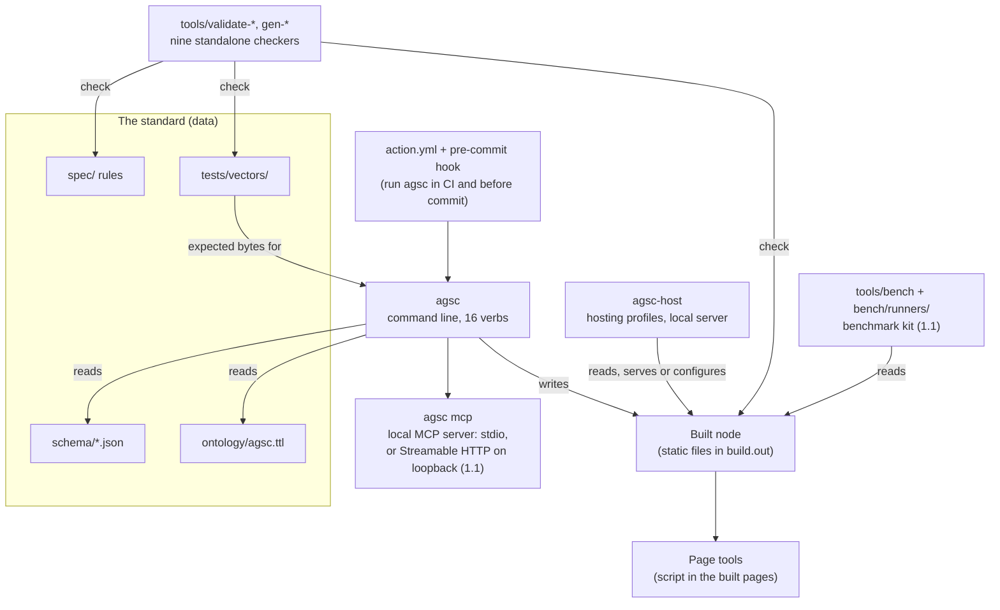

# Architecture — C4 level 2: the containers

**What this shows.** The runnable parts of this distribution and what each reads and
writes. The four folders that define the standard are data every container reads; the
checkers read them without importing any engine code.

The built node holds, from 1.1, the agent card `/.well-known/agent-card.json` of a node that
declares an A2A responder and, on `discovery.ai_catalog`, the catalogue files `ard.json` and
`ai-catalog.json` beside the discovery document. The benchmark kit (1.1) reads a built node as
any consumer does — `tools/bench` scores its published surfaces and `bench/runners/kit.js`
checks the agent-study kit against its chunk export — and imports no engine code.

Trace: AGSC-09-07 (the sixteen verbs), AGSC-09-13 (the local server), AGSC-09-18 and
AGSC-09-19 (its HTTP transport and the two MCP revisions), AGSC-06-34 and AGSC-06-42 (the card
and the catalogue files), AGSC-09-16
(page tools), AGSC-09-90 (independent checkers), AGSC-00-24 (the deployment-profile
plugin kind), AGSC-00-20 and PRD-066 (the benchmark kit).
